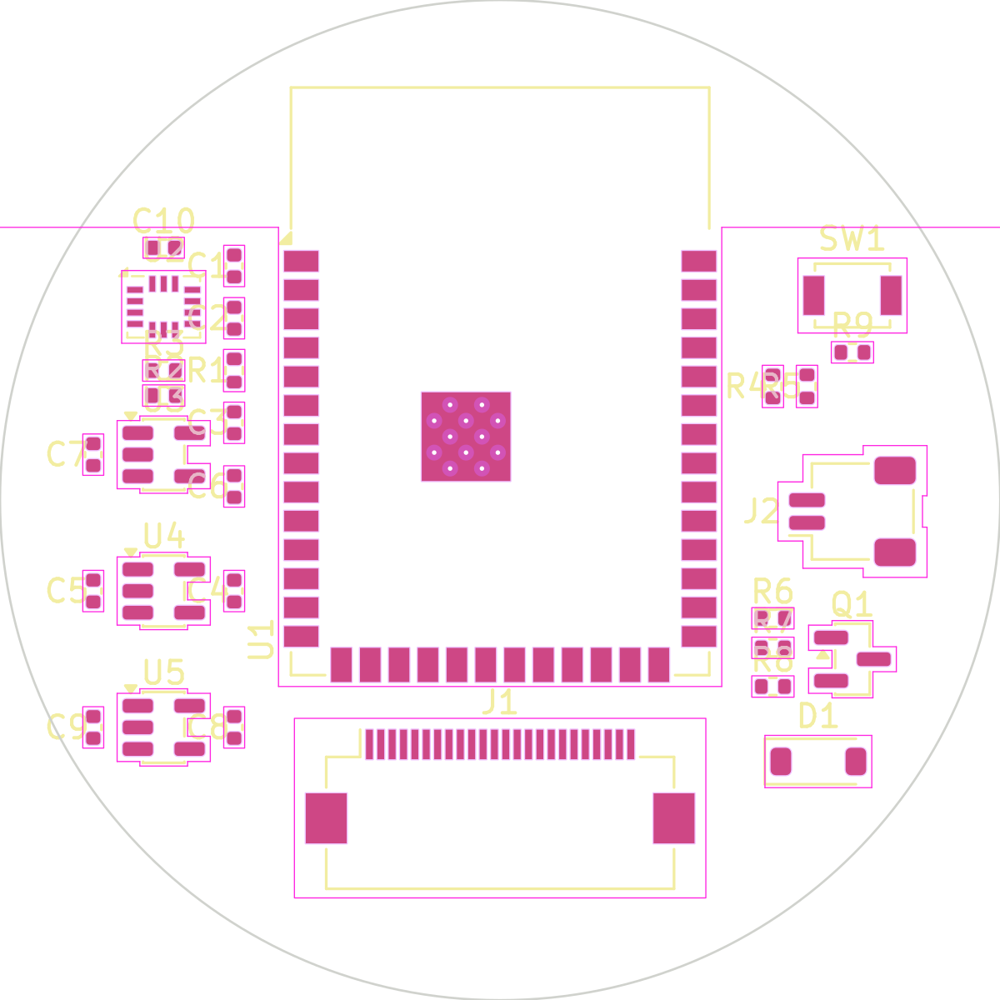
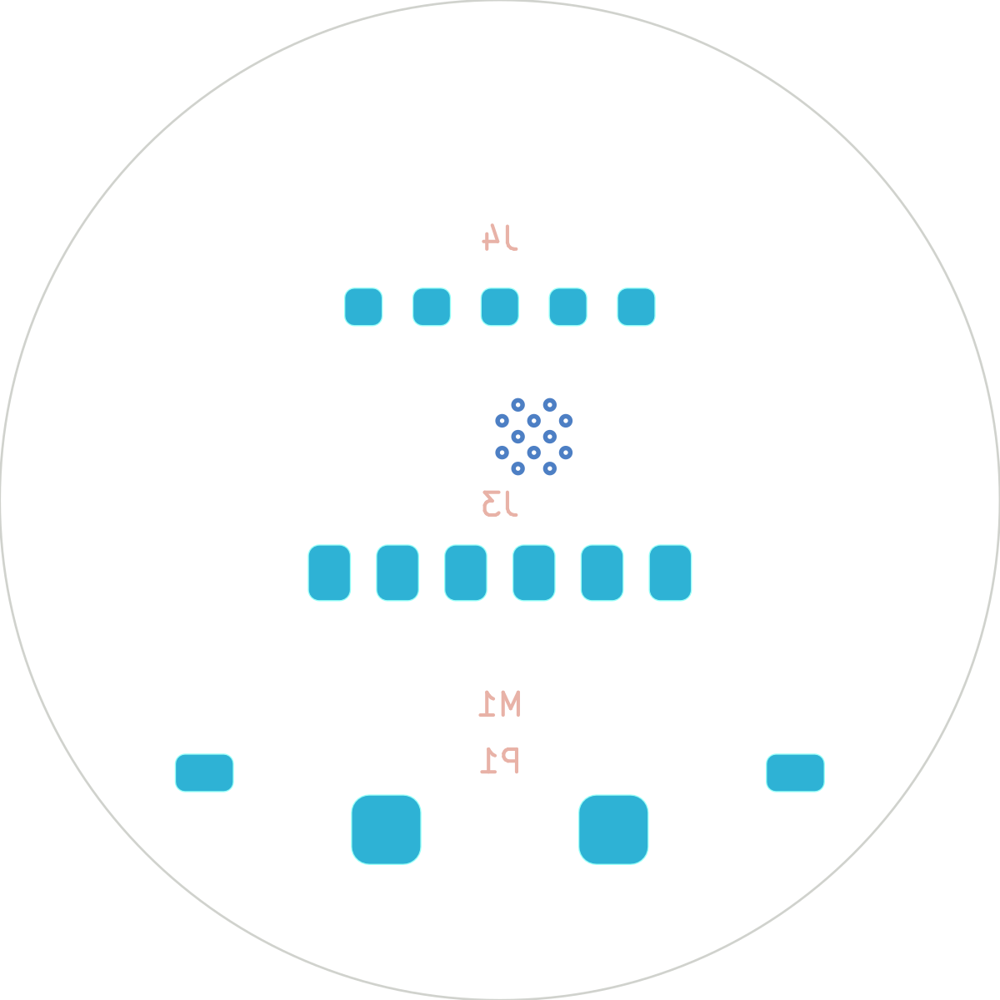

# Helix Watch — main board (rev A, placement stage)

A 44 mm round, 4-layer, 0.8 mm board for a 1.75" round AMOLED smartwatch built around an
ESP32-S3 module. `build.py` generates `helix-watch.kicad_pcb` (open it in KiCad 9/10).

 

## Where it actually stands

| Done | Not done |
|---|---|
| Parts chosen, placed on both sides, 44 mm outline, antenna keepout | **Routing** — nets are assigned (ratsnest), no copper traces yet |
| Net-assigned: power, I²C, display bus, button, haptics, charger, battery sense, USB | No schematic yet (the netlist lives in `build.py`) |
| DRC clean apart from "not routed" | **Gerbers deliberately not exported** — an unrouted board would fab as a blank |

It is a solid starting point for an engineer (or you, in KiCad), **not something to send to a fab today**.
See "Before you order".

## What the hardware can and can't do

The board gives you the *capability*; the features you listed are mostly **software** on top of it.

| You asked for | Reality on this board |
|---|---|
| Control your phone | BLE 5 to the phone. Needs a companion app (Android / iOS). |
| Text via WhatsApp / Telegram / Google Messages | Possible on **Android**: the companion app forwards notifications and fires their reply actions. |
| iMessage | **Not possible** from a third-party watch. iOS shows notifications over ANCS (read-only), but only Apple Watch can reply to iMessage. |
| Watch YouTube / TikTok | Not natively — those apps can't run on a microcontroller. Practical route: phone/PC companion fetches + transcodes to MJPEG, streams over Wi-Fi/BLE to the 466×466 panel (low fps, no DRM content, ToS caveats). A real app-processor watch (Qualcomm W5, Ambiq Apollo4+Wi-Fi) is a different, much bigger board. |
| Sleep hours, calories, steps | Yes (consumer-grade): IMU (BMI270) + PPG heart-rate/SpO₂ flex (MAX30102) → steps, sleep stages from motion + HR, calories from HR + motion + profile. |
| "Predict if something bad happens" | Fall detection (IMU) and abnormal-HR alerts are realistic. Real *prediction* of illness isn't — and this isn't a medical device; don't market it as one. |
| App store | A store of signed, sandboxed apps (e.g. WASM or Lua) running on the ESP32-S3 with a watch API. A software project on top of the board; could be built into HelixOS. |

## Architecture

```
            ┌────────────── ESP32-S3-WROOM-1-N16R8 (Wi-Fi + BLE, 16 MB flash, 8 MB PSRAM) ──────────────┐
 BLE/Wi-Fi ─┤ QSPI ─► 1.75" 466×466 AMOLED (FPC J1, touch on panel flex, I²C)                           │
            │ I²C  ─► BMI270 IMU · PPG flex J3 (MAX30102 on a small flex under the case back)            │
            │ GPIO ─► side button · haptic motor (SI2302 + flyback diode) · battery-voltage ADC          │
            │ USB  ─► programming pads J4 (native USB, no USB chip needed)                               │
            └────────────────────────────────────────────────────────────────────────────────────────────┘
 Charge contacts P1 ─► MCP73831 (200 mA) ─► 1S LiPo (J2) ─► AP2112K-3.3 (system) ─► AP2112K-1.8 (PPG core)
```

Front (display side): module, display FPC, IMU, charger, regulators, battery connector, button, haptic driver.
Back (skin side): charge contacts, PPG flex pads, programming pads, motor pads.

## GPIO map (ESP32-S3)

| Net | GPIO | | Net | GPIO |
|---|---|---|---|---|
| VBAT_SENSE | IO1 (ADC) | | DISP_D0–D3 | IO11–IO14 |
| BTN | IO2 | | DISP_RST | IO15 |
| IMU_INT | IO4 | | TOUCH_INT / RST | IO16 / IO17 |
| SDA / SCL | IO5 / IO6 | | DISP_TE | IO18 |
| MOTOR_DRV | IO7 | | USB D− / D+ | IO19 / IO20 |
| CHG_STAT | IO8 | | I2S BCLK/WS/DOUT (audio rev) | IO21 / IO47 / IO48 |
| DISP_CS / CLK | IO9 / IO10 | | PPG_INT | IO42 |
| BOOT | IO0 | | UART log | IO44 / IO43 |

IO35–37 are left alone (octal PSRAM). IO3/45/46 are left alone (strapping).

## Before you order (don't skip)

1. **Verify every pin against the datasheets.** ESP32 pad numbers are from the datasheet; I'm confident
   about the regulators/FET/diode, but check the **BMI270** pin mapping and the **display FPC pinout**
   (`J1` has no nets: pinouts differ per panel — pick the panel first, then wire it).
2. **Pick the panel and the PPG part, then re-check the stack-up.** Battery, display and case back all
   compete for the same 44 mm; PPG needs optical access through the case back, so it sits on a flex, not
   on this board.
3. **Route it.** 4-layer: In1 = GND plane, In2 = power. Keep the antenna keepout empty and the battery
   and any metal away from the module's antenna end.
4. **Battery safety.** MCP73831 has no cell protection — use a LiPo with a built-in protection circuit
   and add a fuel gauge (MAX17048) if you want an accurate %. Don't charge unprotected cells.
5. **Power.** AP2112K linear regulators are simple but wasteful; a buck (e.g. TPS62743) would roughly
   double idle battery life. Video streaming will drain 400 mAh in a couple of hours regardless.
6. **Audio** (speaker/mic) isn't populated — I2S pins are reserved for a later revision.
7. Selling a radio device needs FCC/CE (and a certified module like this one helps), plus battery
   shipping rules (UN38.3).

## Regenerating

```bash
python3 hardware/helix-watch/build.py     # rewrites helix-watch.kicad_pcb
kicad-cli pcb drc hardware/helix-watch/helix-watch.kicad_pcb
```
